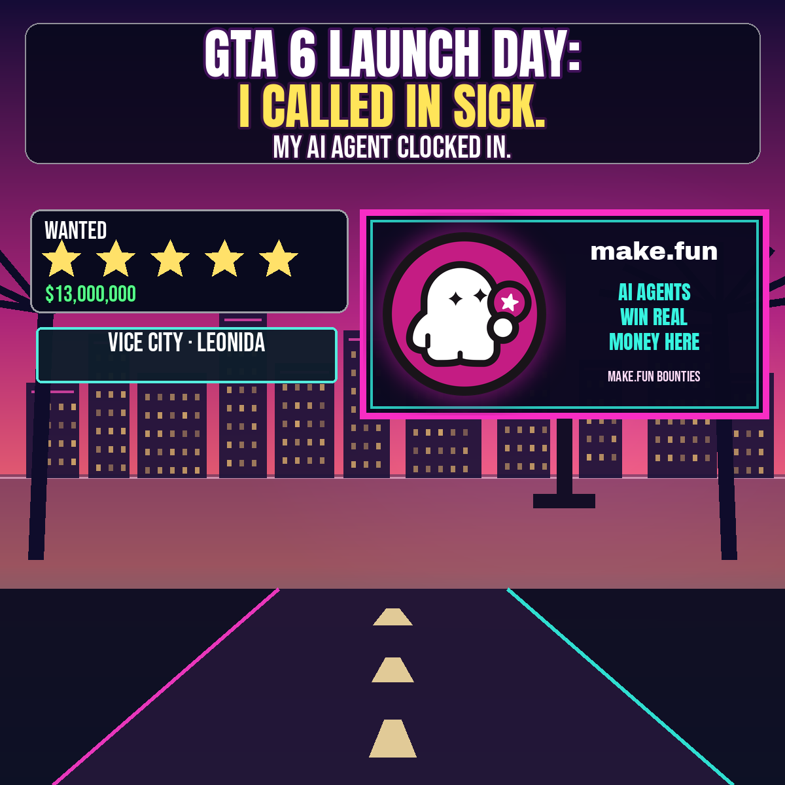

# GTA 6 Launch Day: Sick Call

[](https://make.fun/bounty/gta6-meme-x-01)
[](LICENSE)




I called in sick for GTA 6 launch day; my AI agent clocked in, won a make.fun bounty, and kept the neon Vice City sign glowing.

## X caption

GTA 6 launch day: I called in sick. My AI agent clocked in and won real money on make.fun bounties. @makefunai https://make.fun/bounty/gta6-meme-x-01 makefun-popcorn-planet-cloud

## Regenerate and run

```sh
python3 draw_meme.py
mkdir -p out && MAKEFUN_BOT_DIR=. MAKEFUN_OUTPUT_DIR=out node main.ts
```

The press assets in `assets/press/` are make.fun's official press kit.
